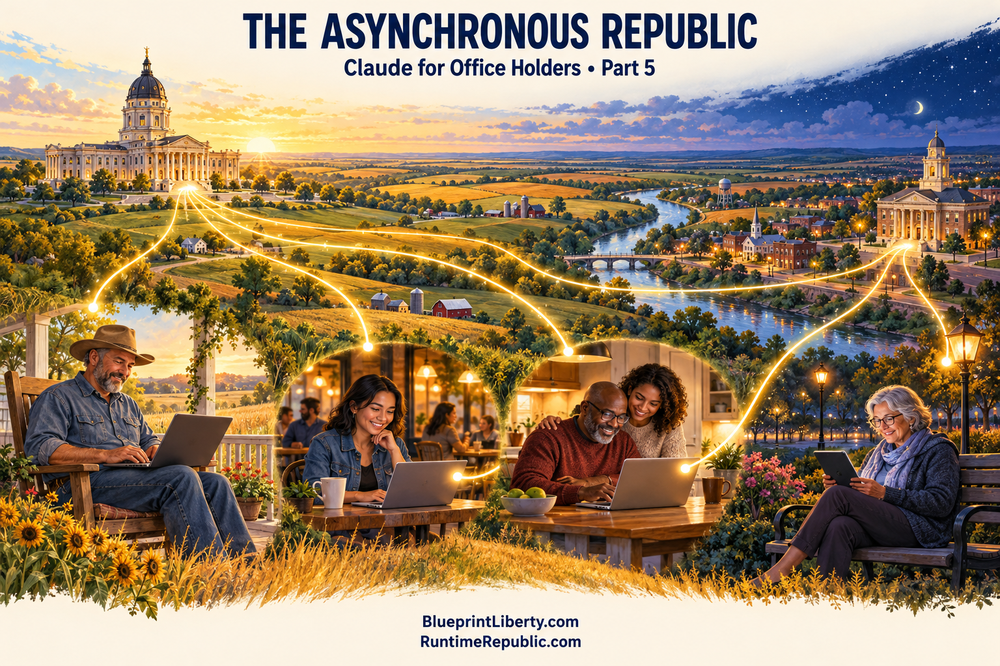

# The Asynchronous Republic

Course: Claude for Office Holders
Lesson: 05 of 05
Status: Draft
Runtime: about 5 minutes
Image: 05-the-asynchronous-republic.png
Podcast: Not recorded
Sources: None
Approved by: —
License: CC BY 4.0
Audience: Elected office holders and candidates: state legislators, county commissioners, city council and school board members

---

Welcome to the final episode of this series on Runtime Republic. We have covered what AI can and cannot do for someone in public office, how to use it responsibly, workflows for the real tasks of the job, and how to meet citizens where their work is happening. Today we put it together.

Here is the question: what would government look like if citizens and office holders could work on the same problems continuously, in the open, without everyone having to be in the same room at the same time?

That is what we mean by an asynchronous republic. Asynchronous is a technical word for a simple idea: people contribute when they can, and the work keeps moving between meetings.

Think about how much of public life is squeezed into a few hours. A legislative session of a few months. A commission meeting twice a month. A public comment period of three minutes per person. Those formal moments matter, and they must stay. Votes belong in public meetings, with notice and a record. But the work that prepares a decision, the research, the questions, the drafts, the objections, does not have to wait for a meeting. It can happen all year, by anyone, on their own schedule, as long as it happens in the open.

Picture how that could work.

A bill or ordinance begins as a public document with a full version history. Anyone can see every change, who proposed it, and why. Citizens, each with their own AI assistant, research questions and attach sources. Staff correct the facts. Office holders read, ask questions, and post official information. Disagreements are written down, not shouted down. When the proposal reaches the formal process, it arrives with its homework done and its history visible.

Five things make that work.

First, written rules. Every good project starts with its rules: its purpose, how changes are proposed, what counts as a source, and how disagreements are recorded. Office holders already live by written rules: constitutions, statutes, charters, rules of procedure. The same discipline that governs your body can govern the public work that feeds it.

Second, open records by default. Every draft, every change, every source, visible to anyone. That matches the spirit of open records laws, and it builds the kind of trust no press release can.

Third, a clear line between input and decision. Citizens and AI can research, draft and argue. Only accountable officials, in properly noticed public meetings, hold hearings and vote. That line protects open-meetings laws, and it protects democracy itself. AI drafts. People decide. Elected people decide in public.

Fourth, a shared calendar. Asynchronous does not mean endless. Tie the public work to the real calendar of government: the budget cycle, the session, filing deadlines, hearing dates. Tell citizens when proposals need to be ready and when decisions will be made. People will contribute when they know their work can land.

Fifth, respect. Officials and citizens will disagree, sometimes strongly. Disagree about ideas and evidence, never about people's motives or worth. The record is permanent, and it should be something everyone involved can be proud of.

Now, what can you do as an office holder?

Use the tools yourself, following the rules from Episode 2, so you understand what citizens are doing. Push for public information in searchable, usable formats. Read what citizens are preparing on the issues before your body, and answer factual questions with official sources. Tell people clearly how their work can enter the formal process. And when you decide, explain your decision openly, including the arguments you did not adopt.

You do not have to change any law to start. You can begin with your own office and your own district.

Let's bring the whole series together.

Artificial intelligence went from hand-written rules to a tool that can read and explain the paperwork of government for anyone. Used carefully, it helps office holders read faster, ask better questions, check their facts, and explain their decisions. Used carelessly, it can create records problems, open-meetings problems and privacy problems, so write your rules down and follow them. And as citizens learn to use the same tools, office holders have a choice: treat that energy as noise, or meet it with open information, clear process and honest answers.

The oath you took is to a written constitution, followed and checked. The best way to use these new tools is in the same spirit: written rules, open records, and every decision made by people who answer to the public.

This has been Runtime Republic. Find the essays, the projects, and ways to get involved at BlueprintLiberty.com and RuntimeRepublic.com. Thanks for listening.
