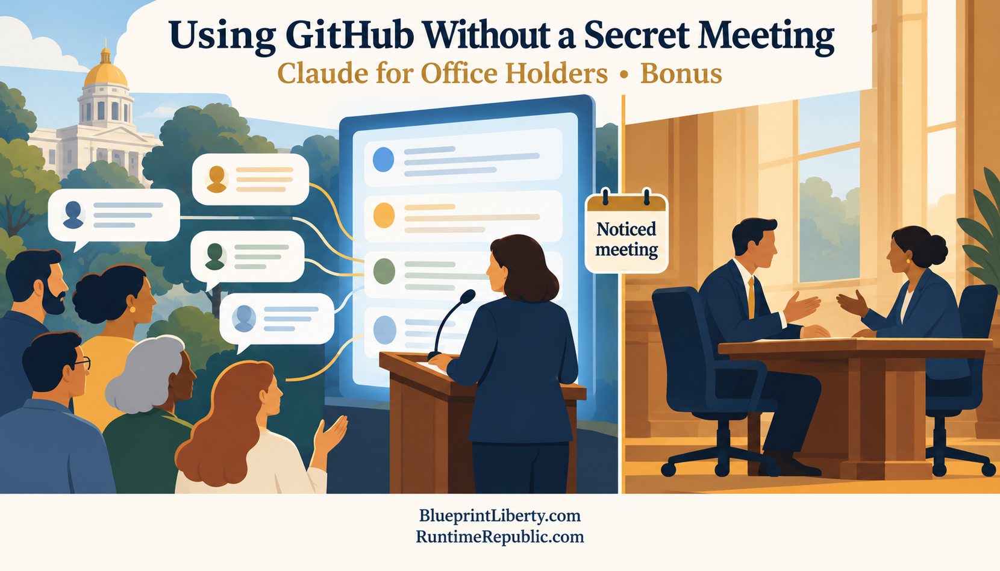

# Using GitHub Without Holding a Secret Meeting

Course: Claude for Office Holders
Lesson: 06 of 06
Status: Approved
Runtime: about 5 and a half minutes
Image: 06-using-github-without-a-secret-meeting.png
Podcast: Not recorded
Sources: None
Approved by: James A. Hodges, 2026-10-30
License: CC BY 4.0
Audience: Elected office holders and candidates: state legislators, county commissioners, city council and school board members
Image header: Using GitHub Without a Secret Meeting | Claude for Office Holders • Bonus

---

Welcome to a bonus episode of Runtime Republic. In Episode 4, we saw citizens organizing on GitHub, and we said office holders could meet them there. Today we answer the question that follows: how do you take part on GitHub without accidentally holding a meeting the law says must be open?

The usual note first. This is not legal advice. The examples use Kansas law, and every state is different. Before you take part in any online project about your body's business, talk with your clerk, your body's attorney, or your legislative staff.

Here is the irony. A public GitHub project is more open than almost any meeting room. Anyone can read every word, and every change is stamped with a name and a time. Yet you can still break the Open Meetings Act there. Here's how.

Kansas's Open Meetings Act counts as a meeting any gathering where a majority of a body discusses its business, in person or through any way of talking back and forth. The Attorney General has said that back and forth means a real exchange between members. The Attorney General has also said it doesn't have to happen in real time. A conversation spread over a week can still count. And, as we said in Episode 2, a series of messages can count as a meeting if, together, they involve a majority of the body, share a common topic of its business, and are meant to reach agreement on something that needs a binding vote.

In 2025, the Legislature's own legal staff, the Revisor of Statutes, put it in plain terms. Internet forums where members can reply to each other may count as meetings. A one-way email generally does not.

Now picture a comment thread on a citizen project about next year's budget. You post a view. A colleague replies. A third member adds a thumbs-up. Over a few days, a majority of your body has weighed in, and you are leaning toward the same answer. The whole world can read it. But no notice was given, and that is what the law requires. Being public is not the same as being properly noticed.

So here is a simple pattern that keeps you on the right side of the line. Think of it as five habits.

Habit one: read freely.

Reading a public project is not a meeting. Neither is following it, or watching for new issues in your district. Read as much as you like. It is one of the best ways to learn what your constituents are working on.

Habit two: post one way.

You can share information, the same way you would send a newsletter or speak at a public forum. Post a link to the official budget. Explain what a line item pays for. Correct a factual error with an official source. Then let it stand. A post is a statement, not a conversation with your colleagues.

Habit three: talk with citizens, not with your colleagues.

Answering a constituent's question in a public thread is much like answering it at a town hall. What you avoid is a back and forth with other members of your own body about a matter that is coming before you. If a colleague replies to you in a thread, don't continue the exchange there. Save it for a properly noticed meeting. And be careful with reactions. A thumbs-up on a colleague's position can look like agreement being built outside public view.

Habit four: never decide online.

No straw polls. No "let's agree to vote yes." No approving a citizen's proposal on behalf of your body. Projects can prepare, research and draft. Only your body, in a noticed meeting, can decide. When the decision comes, say on the record which version of the proposal you are voting on.

Habit five: keep it professional, because it is a record.

As we said in Episode 2, Kansas treats records about official business as public records even on personal accounts. Assume everything you post about your body's business can be requested. Use one account for your public role, write as you would on the record, and never post information that is not already public.

Some people argue the law should change. They point out that a public, permanent, timestamped thread is the opposite of a back room, and that the law should treat a properly run public repository as an open meeting. That is a proposal, explored in our series called The One-Hour Rule. It is not the law today. Until the law changes, follow the habits.

Let's recap. A public project is open, but openness is not notice. A back and forth among a majority of your body about its business can be a meeting, even if it takes a week. So read freely. Post one way. Talk with citizens, not with your colleagues. Never decide online. And treat every post as a public record.

This has been Runtime Republic. Find the essays, the projects, and ways to get involved at BlueprintLiberty.com and RuntimeRepublic.com. Thanks for listening.

<!-- series-navigation: start -->

---

### Continue reading

[← Previous essay](../05-the-asynchronous-republic/lesson.md) · [Series index](../README.md)

[All series in this repository](../../README.md) · [Repository home](../../../README.md)

<!-- series-navigation: end -->
