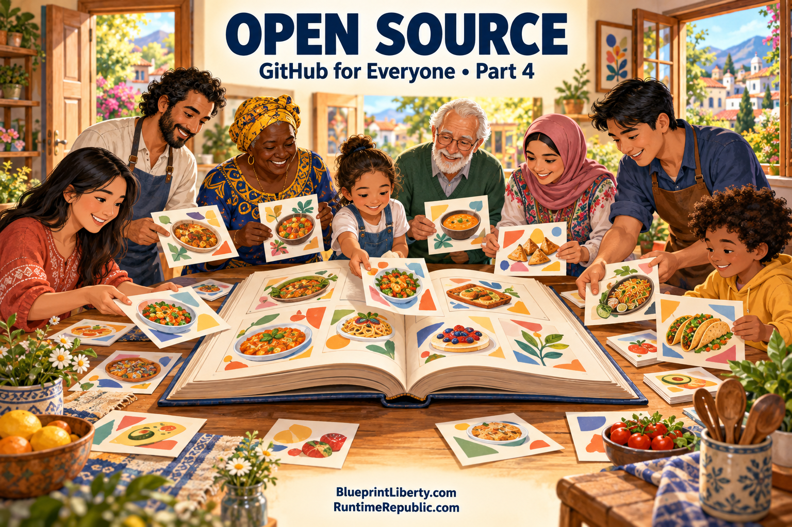

# Open Source, Building Things for Everyone

Course: GitHub for Everyone
Lesson: 04 of 07
Status: Draft
Runtime: about 6 and a half minutes
Image: 04-open-source.png
Podcast: Not recorded
Sources: None
Approved by: —
License: CC BY 4.0
Audience: Ages 10 and up
Image header: Open Source | GitHub for Everyone • Part 4

---

So far, we've learned what GitHub is, where it came from, and the names of the tools in its toolbox. Today, we're going to talk about one of the most generous ideas in all of technology. It's called open source. And it's the reason GitHub became so important.

Let's begin with a question. When you buy a cake from a bakery, do they give you the recipe? Usually not. The recipe is a secret. That's how the bakery makes money. You can enjoy the cake, but you can't see how it was made, and you certainly can't change it.

A lot of software works the same way. The company writes the code, keeps it secret, and sells you the finished program. That's called closed source, or proprietary software. There's nothing wrong with it. Many great programs are made this way.

But open source is different. Open source means the recipe is shared with everyone. Anyone can read the code, learn from it, use it, and improve it. It's like a bakery that hands out its recipes for free and says, "Go ahead. Bake it yourself. And if you find a way to make it tastier, please tell us."

You might wonder, why would anyone give away their work for free? There are lots of reasons. Some people do it because they enjoy helping others. Some do it to learn and build their skills. Some companies do it because when thousands of people look at the same code, they find mistakes faster and come up with better ideas. There's a famous saying among programmers: with enough eyes, all bugs are shallow. A bug, by the way, is a mistake in code. The idea is that when many people are watching, problems are easier to spot and fix.

Here's an amazing example. Remember Linus Torvalds, the man who created Git? Years before Git, back in 1991, he started an open source project called Linux. Linux is a set of instructions that runs the deepest parts of a computer. Today, versions of Linux run most of the world's websites, nearly all of the world's supercomputers, and even the inside of most Android phones. Thousands of volunteers and companies have helped build it. And it's free.

So how does open source stay fair? With something called a license. A license is a set of rules the creator attaches to their project. It's like a sign that says, "Here's what you're allowed to do with my work." Some licenses say, "Do anything you want, just give me credit." Others say, "You can use and change this, but if you share your changed version, you must share it openly too, so others can keep improving it." On GitHub, you'll usually find the license in a file named LICENSE, right next to the README.

GitHub became the town square for open source. Before GitHub, open source projects were scattered across many different websites and mailing lists. GitHub brought them together in one place, with forks, pull requests, and issues that made it easy for strangers to help each other. By 2023, GitHub said more than one hundred million people had accounts. Many of the apps and websites you use every day are built partly on open source projects that live there.

But here's the surprising part. GitHub isn't only for code.

Because Git can track changes to any kind of text, people have found all sorts of creative uses for it. Writers have used GitHub to write books together, with each chapter improved through pull requests. Teachers share lesson plans. Scientists share their data and research so other scientists can check their work and build on it. People share recipes, knitting patterns, and even lists of their favorite things. Many people build entire websites for free using a feature called GitHub Pages, which turns files in a repository into a real web page anyone can visit.

Even governments have joined in. Some cities and countries have published their laws on GitHub, so citizens can read them and see exactly how they've changed over time. In Washington, D.C., the official law code was posted on GitHub, and in 2018, an ordinary citizen noticed a small mistake in it. He opened a pull request to fix it, and the government accepted it. Think about that. A regular person helped correct the law, using the same tools programmers use to fix a video game. Keep that story in mind. We'll come back to it.

And here's one more fun fact. In 2020, GitHub took a huge collection of open source code, stored it on special long-lasting film, and buried it deep inside a mountain on an island in the Arctic, near the North Pole. It's called the Arctic Code Vault. The idea was to protect the world's shared software for a thousand years, so that future generations can see what we built together.

Let's review. Open source means sharing the recipe so anyone can read, use, and improve the code. A license sets the rules for how it can be used. Linux is one of the most famous open source projects in the world. GitHub became the gathering place for open source. And people use GitHub for far more than code, from books and science to websites and even the law.

In Part Five, our last main essay, we'll look at where GitHub is today and where it might be going. We'll talk about artificial intelligence that helps write code, the debates people have about it, and what all of this means for anyone who wants to build something.

Here's your thinking question. If you could share one recipe, one idea, or one project with the whole world for free, what would it be, and what rules would you want people to follow when they use it?
