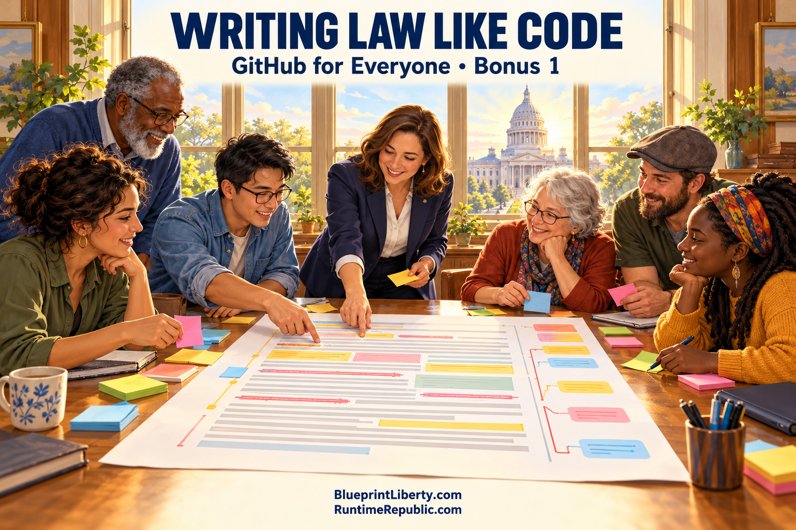

# Writing a Law the Way We Write Code

Course: GitHub for Everyone
Lesson: 06 of 07
Status: Draft
Runtime: about 7 and a half minutes
Image: 06-writing-law-like-code.png
Podcast: Not recorded
Sources: None
Approved by: —
License: CC BY 4.0
Audience: Teens and adults; follows Parts 1 to 5
Image header: Writing Law Like Code | GitHub for Everyone • Bonus 1

---

In Part Four, we heard about a citizen in Washington, D.C., who spotted a mistake in the law and fixed it with a pull request. Today, let's take that idea much further. What if voters and lawmakers used GitHub to write a brand new bill together, from the very first word?

First, a quick reminder of how a bill usually gets written. A lawmaker hears about a problem, maybe from a neighbor, a business, or a news story. The lawmaker asks staff to write a draft. In Kansas, that drafting is done by a nonpartisan office called the Revisor of Statutes. The draft gets a number, goes to a committee, gets hearings and amendments, and eventually comes up for a vote. Voters can testify and call their representatives, but most of the actual writing happens out of view. By the time most people hear about a bill, the words are already mostly set.

Now imagine a different way. Imagine the bill has a home on GitHub, a public repository, where every word, every change, and every reason for every change is visible to anyone.

Let's walk through it, using every tool from our toolbox.

It starts with the README. Before a single line of law is written, the README explains in plain language what problem the bill is trying to solve. For example: Kansas families are losing their homes because they can't keep up with property taxes. What should be done about that? Anyone can read it, from a lawmaker in Topeka to a farmer in a small county.

Next come issues, the bulletin board. Voters open issues to describe how the problem touches their lives. A retired teacher writes about her rising tax bill. A county clerk explains how collection actually works. A school board member raises a question about how schools would be funded if the tax changed. Each issue is a piece of evidence, out in the open, attached to a real concern.

Then comes something the best engineers insist on: definitions before drafting. Think back to our cookbook. If one person thinks a cup means a coffee mug and another thinks it means a measuring cup, the recipe fails. Laws fail the same way. What exactly counts as a home? What counts as property? Writing those definitions first, in their own files, and reviewing them before anyone uses them, prevents arguments later.

Now the draft itself. The main branch holds the current official version of the bill. Anyone with an idea, whether a voter, a legal expert, or a legislator's staff member, can fork the repository or create a branch and propose a change. Maybe someone thinks the bill should protect seniors first. They write that change on a branch and open a pull request. That pull request becomes a public conversation. Supporters explain why. Critics point out problems. Someone asks, what will this cost? Someone else links to the state law the change would affect. The person who proposed it makes fixes, and every fix becomes another commit with a note explaining why.

Here's where it gets powerful. The commit history becomes a complete legislative history. Years from now, if a judge or a citizen wonders why a sentence says what it says, they can trace it back to the exact change, the exact conversation, and the exact reason. Nothing is hidden in a back room. Every fingerprint is visible.

And conflicts? Remember, a conflict isn't a fight. It's a sign that two people want the same sentence to say different things. In ordinary politics, those disagreements often get settled privately. On GitHub, both versions sit side by side, and everyone can see exactly what the choice is.

Now, some very important guardrails. Writing a bill on GitHub does not make it law. Only the legislature can pass a law, and only by the process the state constitution sets out. A repository is a workshop, not a capitol building. Publishing a draft is not the same as enacting it. And while AI helpers can be useful for research, checking definitions, or spotting inconsistencies, AI should never be the one approving anything. At every important step, a human being, accountable to voters, has to look at the work and say yes or no. Think of those steps as gates. The work can't move forward just because it exists. Someone with real authority has to open the gate.

There's also a structure to this work, just like there's a structure to building a house. You don't start by painting walls. You identify the need. You write a specification describing what the bill must accomplish and what it won't do. You research which parts of the constitution and existing law it touches. You write definitions. Only then do you draft. After that comes a fiscal analysis, an honest estimate of what it costs and who pays, and then review, human approval, and finally a polished package ready to hand to a lawmaker for introduction.

Of course, this approach has real challenges. Not everyone knows how to use GitHub, so a project like this needs plain-language summaries and simpler ways for people to join in. Popular public projects can attract spam, bad-faith arguments, or organized pressure campaigns, so someone has to moderate fairly. And people will disagree, sometimes strongly, about what the bill should do. A property tax bill, for example, raises hard questions about how schools, roads, and local services would be paid for. The tools don't settle those disagreements. What they do is make the disagreements visible, documented, and honest.

That's the real promise here. GitHub was built so that thousands of strangers could build something together without losing track of who did what and why. A law is also something thousands of people have to live with. It makes sense that they could help build it in the same open way.

But there's still one missing piece. A public repository only helps if people know something is happening. Most voters will never check a GitHub page on their own. When a pull request opens that would change how their county collects taxes, or a hearing is scheduled on a bill that affects their district, how would they ever find out?

That's the question for our next essay. We'll look at a phone app that works like a signal flare, one that sends an alert only to the people in the exact voting districts a bill affects, without ever knowing their home address, and turns staying informed into a five-minute monthly habit.

Here's your thinking question. If you could see every change ever made to a law, and the reason behind it, what's the first law you'd want to look at?

<!-- series-navigation: start -->

---

### Continue reading

[← Previous essay](../05-robots-helpers-road-ahead/lesson.md) · [Series index](../README.md) · [Next essay →](../07-the-signal/lesson.md)

[All series in this repository](../../README.md) · [Repository home](../../../README.md)

<!-- series-navigation: end -->
