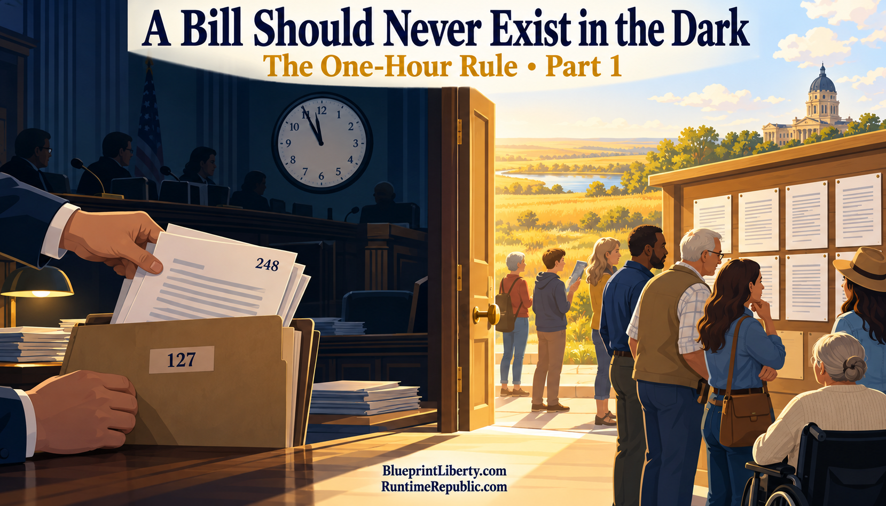

# A Bill Should Never Exist in the Dark

Course: The One-Hour Rule
Lesson: 01 of 05
Status: Review
Runtime: about 3 minutes
Image: 01-a-bill-should-never-exist-in-the-dark.png
Podcast: Not recorded
Sources: None
Approved by: —
License: CC BY 4.0
Audience: Kansas citizens and office holders

---

Kansans fund every law their Legislature passes. They should be able to read each law before it is decided, not after. Today, they often cannot.

The clearest example is a practice called the "gut and go." Lawmakers take a bill, strip out all of its text, and pour new text into it. The new text is often on a completely different subject, and it travels under a different bill number. That makes it hard for anyone outside the Statehouse to follow a bill's progress. Often the main record of what happened is just a recording of a conference committee meeting.

Here is a real example. In 2017, Kansas passed a new formula for funding its public schools. That formula was carried inside a bill that had started out as a rewrite of insurance regulations.

Conference committees are where the final decisions get made. A few members from the House and a few from the Senate meet to settle their differences. Once they agree, each chamber votes the report up or down, and no amendments are allowed. These meetings take no public testimony and have no agenda. They are often scheduled with little notice, and they sometimes run late into the night.

The Legislature does have a rule about this, called Joint Rule Three F. It says copies of a conference committee report must be available to members thirty minutes before the report is considered. Thirty minutes is not much time to read a final bill. And even that short wait can be set aside by a two-thirds vote of the members present. A safeguard that can be waived by a vote at the very moment it matters is not much of a safeguard.

None of this requires bad intent. Legislative leaders have defended the gut and go as a useful tool. One House majority leader put the challenge plainly: if you eliminate it, you have to replace it with something that lets the system keep working.

This series accepts that challenge. The replacement is not a ban on fast work. It is a simple rule. Every version of every bill must be public, timestamped and permanent before anyone acts on it.

Let's recap. Kansans pay for every law, but they often cannot read a bill before it is decided. The gut and go hides new text inside old bill numbers. Conference committees make final decisions with little notice and no amendments. And the only waiting rule gives members thirty minutes, which two-thirds of them can waive. The answer this series proposes is a simple one: no bill in the dark.

In the next essay, we'll look at that rule up close, and how anyone could check that it was followed.

<!-- series-navigation: start -->

---

### Continue reading

[Series index](../README.md) · [Next essay →](../02-the-one-hour-rule/lesson.md)

[All series in this repository](../../README.md) · [Repository home](../../../README.md)

<!-- series-navigation: end -->
