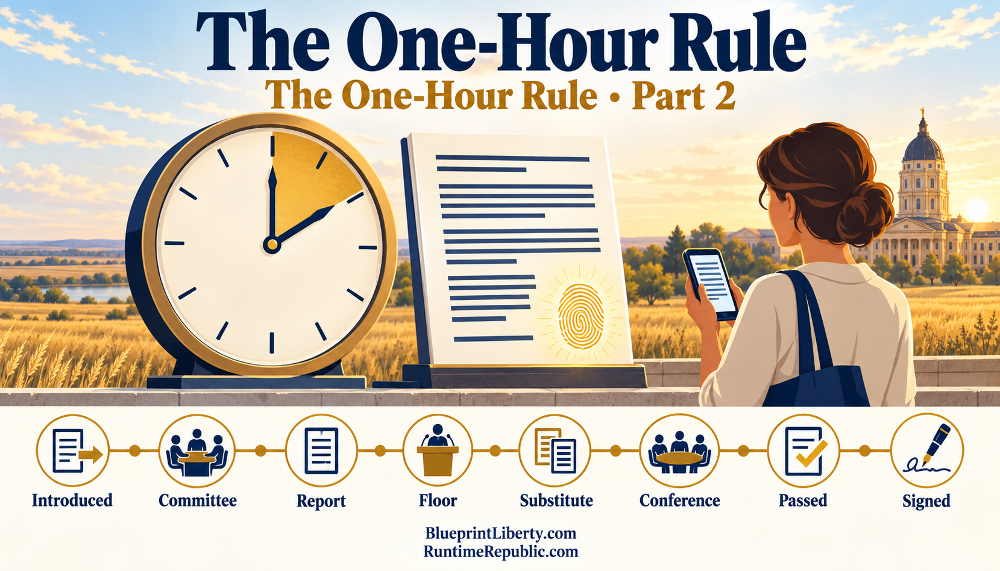

# The One-Hour Rule

Course: The One-Hour Rule
Lesson: 02 of 05
Status: Draft
Runtime: about 3 and a half minutes
Image: 02-the-one-hour-rule.png
Podcast: Not recorded
Sources: None
Approved by: —
License: CC BY 4.0
Audience: Kansas citizens and office holders

---

The rule fits in one sentence. No official action may be taken on any bill unless that exact text has been posted publicly in the official repository for at least sixty minutes.

A repository is a public storage place for documents that keeps every version ever saved. The system behind it is called Git. Each time a version is saved, Git stamps it with the time and gives it a unique fingerprint, called a hash. If even one comma changes, the fingerprint changes. So a vote can name the exact fingerprint it is voting on. Then any citizen can confirm that the text was posted an hour earlier and has not changed since.

The rule applies at every step where a bill's text can change or become binding.

First, introduction. A bill gets its number only once it is posted.

Second, committee amendments. Each proposed change is posted on its own, showing exactly which lines it adds and which it removes.

Third, the committee report. The version a committee recommends is posted an hour before the committee's final vote.

Fourth, floor amendments. Each one is posted an hour before it can be adopted.

Fifth, the gut and go. A replacement is posted as a full change, so the old text and the new text sit side by side for anyone to compare.

Sixth, the conference committee report. The agreed text is posted an hour before either chamber votes on it.

Seventh, final passage. The bill sent to the Governor must match a posted version exactly.

And eighth, the Governor's action. A signature or veto names the fingerprint of the bill being signed or vetoed.

The enforcement is what makes this more than good manners. If an action does not point to a version posted at least an hour earlier, it has no legal effect. And a bill whose text never entered the repository is simply not a bill.

One hour is a floor, not a goal. It is short enough that it rarely slows down real work, even in the rush at the end of a session. It is long enough for reporters, advocates, constituents and the lawmakers themselves to see what changed and speak up before the vote.

The same repository can also feed apps, which could alert a taxpayer the moment a bill touching their taxes is posted. That way the hour is spent reading, not searching.

Let's recap. The one-hour rule says no action on any bill text unless it has been public for at least an hour. Git gives every version a time stamp and a fingerprint, so anyone can check. The rule covers every step, from introduction to the Governor's desk. An action that skips it has no effect. And the hour is a minimum, meant for reading, not delay.

In the next essay, we'll face an irony: using a public repository the wrong way could break the Kansas Open Meetings Act.

<!-- series-navigation: start -->

---

### Continue reading

[← Previous essay](../01-a-bill-should-never-exist-in-the-dark/lesson.md) · [Series index](../README.md) · [Next essay →](../03-open-meetings-meet-open-repositories/lesson.md)

[All series in this repository](../../README.md) · [Repository home](../../../README.md)

<!-- series-navigation: end -->
