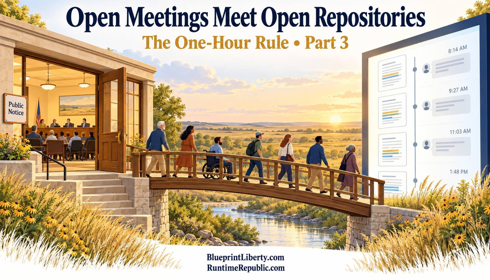

# Open Meetings Meet Open Repositories

Course: The One-Hour Rule
Lesson: 03 of 05
Status: Draft
Runtime: about 3 minutes
Image: 03-open-meetings-meet-open-repositories.png
Podcast: Not recorded
Sources: None
Approved by: —
License: CC BY 4.0
Audience: Kansas citizens and office holders

---

There is an irony at the heart of this idea. A public repository is more open than almost any meeting room. Yet using it the wrong way could break the Kansas Open Meetings Act.

That law, often called KOMA, counts as a meeting any gathering where a majority of a public body discusses its business. It doesn't matter whether they meet in person or through some other way of talking back and forth. The Kansas Attorney General has said that talking back and forth means a real exchange between members. The Attorney General has also said the exchange doesn't have to happen in real time. A conversation spread out over days can still count.

In 2025, the Legislature's own legal staff, the Revisor of Statutes, put it in plain terms. Internet forums where members can reply to each other may count as meetings. A one-way email generally does not.

Now apply that to a repository. Posting a new version of a bill is one-way, like issuing a press release. But picture a comment thread on that bill where a majority of a committee argue with each other over a week. That could be a meeting held without the public notice the law requires. And under the law as written, the fact that the whole world can read the thread does not fix the missing notice.

That is backwards. The Open Meetings Act was written to stop decisions made in back rooms and through private chains of phone calls. A public, timestamped, permanent thread is the opposite of a back room. The fix is not to keep officials off these platforms. The fix is to recognize in law that a properly run public repository is itself an open meeting.

Until the law changes, the safe pattern is clear. Office holders post the text and explain it. The public, staff and the press comment. Members do not debate each other in the threads. They deliberate and vote only in properly noticed meetings, and they cite the exact version they are voting on.

Let's recap. The Open Meetings Act treats a back-and-forth exchange among a majority of a body as a meeting, even if it is spread over days. A one-way post is generally fine. A comment thread where members debate each other could be a meeting without notice, even though anyone can read it. The law should recognize a public repository as an open meeting. Until it does, office holders post and explain, the public comments, and members deliberate only in noticed meetings.

In the next essay, we'll ask what laws would have to change, and where the one-hour rule should live so it can't be voted away.

<!-- series-navigation: start -->

---

### Continue reading

[← Previous essay](../02-the-one-hour-rule/lesson.md) · [Series index](../README.md) · [Next essay →](../04-what-it-would-take-legally/lesson.md)

[All series in this repository](../../README.md) · [Repository home](../../../README.md)

<!-- series-navigation: end -->
