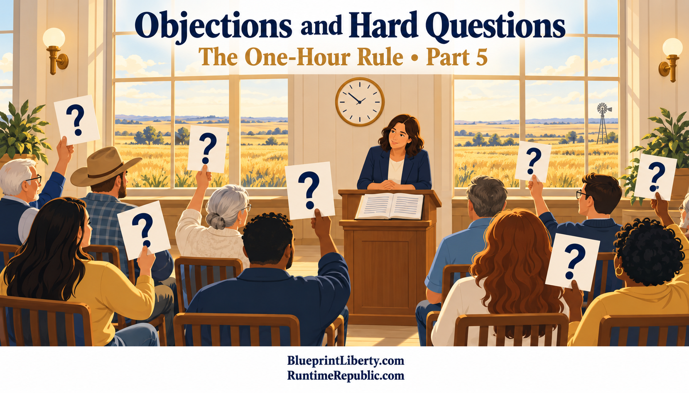

# Objections and Hard Questions

Course: The One-Hour Rule
Lesson: 05 of 05
Status: Review
Runtime: about 3 minutes
Image: 05-objections-and-hard-questions.png
Podcast: Not recorded
Sources: None
Approved by: —
License: CC BY 4.0
Audience: Kansas citizens and office holders

---

An idea worth adopting has to survive its best objections. Here are the ones Kansans and lawmakers are most likely to raise, with the best answers available today.

The first objection: Kansas law should not depend on one private company. This is the strongest objection, and it is right. The law should name an open standard, Git, and a state-run repository as the official record. GitHub and other services can carry public copies. If any of them goes down or changes its terms, the official record is untouched.

The second: what about emergencies? A flood, an attack or a court deadline may require action within minutes. The rule can allow an emergency exception by a two-thirds vote, which skips the one-hour wait. But even then, the text must be posted before the vote. Things can move fast, but they can never move in secret.

The third: one hour is too short to matter. For a four-hundred-page budget, that's true. The hour is a floor that prevents surprises, not a replacement for hearings. A longer wait for long bills, or for conference committee reports, would be a reasonable addition.

The fourth: lawmakers don't know how to use Git. They don't have to. The Revisor's office already drafts every bill, and its staff would do the posting. Legislators would see an ordinary web page showing what changed, with deletions in red and additions in green.

The fifth: this will chill honest discussion among members. Members can still talk privately in groups smaller than a majority, just as they can now. The only change is that the text they act on becomes public first.

The sixth: who enforces it? Under a constitutional rule, any citizen could challenge a law whose text was not posted in time. A court could check the timestamp in seconds. That is far easier than proving what was said in a back room.

And the last: will the public even read it? Most people won't read every bill, and they don't need to. Reporters, advocates and alert apps will, and they will tell everyone else.

Let's bring the whole series together. Kansans fund every law, but too often they can't read a bill before it is decided. The one-hour rule fixes that: no action on any bill text unless it has been public, timestamped and unchanged for at least an hour. The Open Meetings Act should treat a public repository as an open meeting, not a violation. The rule should start as a joint rule, move into statute, and end in the Kansas Constitution. And it must rest on an open standard and a state-run record, never on one private company.

This has been Runtime Republic. Find the essays, the projects, and ways to get involved at BlueprintLiberty.com and RuntimeRepublic.com. Thanks for listening.

<!-- series-navigation: start -->

---

### Continue reading

[← Previous essay](../04-what-it-would-take-legally/lesson.md) · [Series index](../README.md)

[All series in this repository](../../README.md) · [Repository home](../../../README.md)

<!-- series-navigation: end -->
